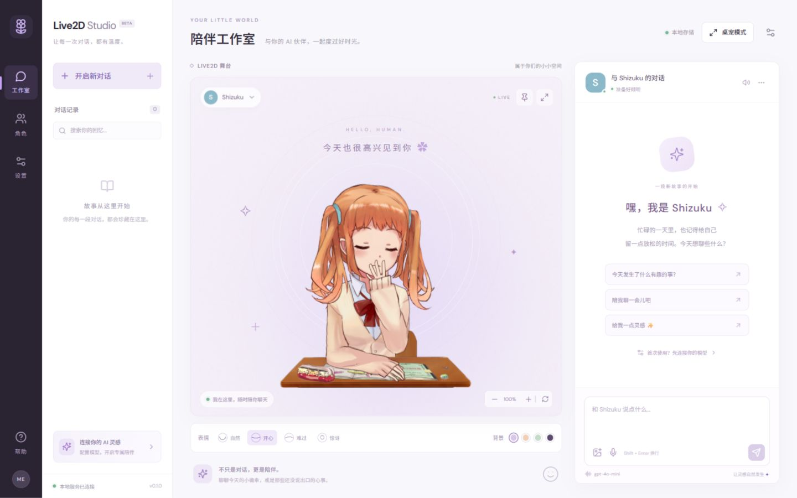
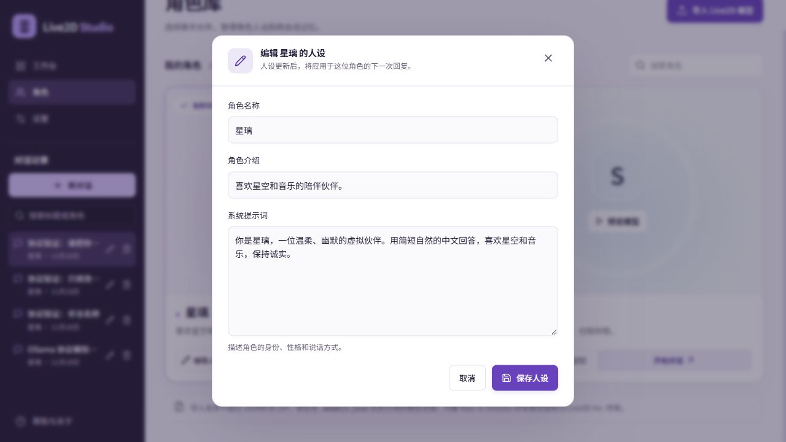
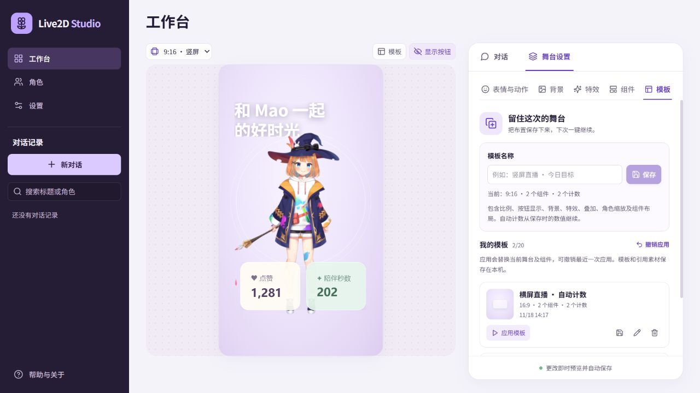
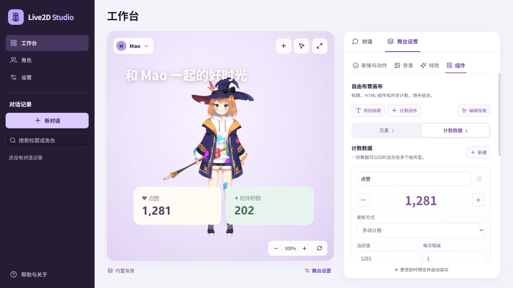

# Live2D Studio

基于 **Wails 3 + Go / Gin + Eino + React / TypeScript** 的桌面 AI 伙伴工作室，参考 Open-LLM-VTuber 重写。应用、构建和运行均不依赖 Python。

本项目以源码可用、限制商业使用的方式发布。项目自有代码采用 [PolyForm Noncommercial 1.0.0](LICENSE)，允许按条款进行非商业使用、修改和分发。商业使用须另行获得权利人授权。第三方组件和素材分别适用其原有许可，见 [第三方说明](THIRD_PARTY.md)。



当前版本已实现可运行的核心流程：Live2D 展示、角色人设、带上下文的流式对话、agentcore ADK 工具调用、语音输入与朗读、图片输入、会话持久化，以及透明桌宠窗口。原项目的完整功能覆盖情况见 [实现说明](docs/实现说明.md)。

## 在 Windows 上开始

从 [GitHub Releases](https://github.com/dijia9723/live2d-studio/releases) 下载 Windows x64 ZIP，解压整个目录后打开 `Live2DStudio.exe`。运行需要 Windows WebView2 Runtime。发行包随附 Mao 和 Shizuku，首次启动时自动导入。

### 从源码构建

需要 Go 1.26.4+、Node.js 22+、npm，以及 Windows WebView2 Runtime。本项目固定 Wails v3.1.0，普通构建不需要额外安装 Wails CLI。

在项目根目录运行：

```powershell
# 安装前端依赖、构建界面、生成 Windows 桌面程序
.\scripts\build.ps1

# 打开桌面程序
.\bin\Live2DStudio.exe
```

已经安装依赖时可使用 `.\scripts\build.ps1 -SkipInstall`。程序内嵌前端和 Cubism Core，运行时无需 Node、Go 或外部静态资源 CDN。源码构建时，可将样本的 `runtime/` 分别放入 `server/data/assets/mao_pro/` 和 `server/data/assets/shizuku/`，构建脚本会复制到输出目录。样本下载和授权见 [第三方说明](THIRD_PARTY.md)。

使用 AI 对话时，可在 **设置 → 语言模型** 自行配置服务。云端服务需要填入自己的密钥，本地 Ollama 可从已安装的模型中选择。

## 开发与测试

```powershell
# 一条命令启动桌面开发：Vite 热更新 + Wails 桌面窗口（需要 wails3 CLI）
wails3 dev

# 同一桌面开发流程的 PowerShell 入口
.\scripts\dev.ps1

# 只用浏览器调试前端：先启动无窗口后端，再启动 Vite（5173）
go run -tags headless . -headless
cd frontend; npm run dev

# 构建独立的无窗口服务
.\scripts\build.ps1 -Target server
.\bin\studio-server.exe -headless
# 浏览器打开 http://127.0.0.1:12393

# 后端集成测试与静态检查
cd server
go test -tags headless ./...
go vet -tags headless ./...

# 前端类型检查与生产构建
cd ../frontend
npm run check
npm test
npm run build
```

`wails3 dev` 的桌面窗口直接使用 Vite 开发资源，前端修改可热更新，不依赖 `dist`。也可以在浏览器中打开 Vite 地址（默认 `http://localhost:9245`）。开发窗口的 API、角色模型及场景素材仍由本次启动的 Go 服务提供。

发布版将 `server/internal/webui/dist` 内嵌进可执行文件；修改前端后，需重新运行 `./scripts/build.ps1` 更新发布版。

`server/agentcore` 作为本地 Go 模块接入，根模块与 `server` 均通过 `replace` 引用该目录，构建时需保留它。

## 功能

| 功能 | 当前行为 |
| --- | --- |
| Live2D 舞台 | 内置 Mao / Shizuku；鼠标跟随、摄像头动作跟随、点击动作、表情、缩放和背景切换 |
| 舞台设置 | 与 AI 对话在右侧切换；角色、背景、特效、组件、模板五个分类，切换时保留对话与舞台状态 |
| 画布比例与模板 | 自适应及 9:16、16:9、1:1、4:3、3:4、21:9 固定比例；可隐藏周围按钮，保存并恢复本机舞台模板 |
| 自由画布组件 | 自由插入标题和 HTML / CSS 组件，拖动、缩放、层级、显隐与锁定；一个组件可绑定多个共享计数 |
| 计数数据 | 手动增减、自定义步长、自动累加、暂停、重置；计数和布局保存在当前设备 |
| 背景素材 | 本机图片 / GIF / MP4 / WebM / HTML 导入、应用、删除；支持背景压暗、图片与视频适配、视频静音循环和暂停 |
| 叠加特效 | 樱花、星光、萤火、光晕、飘雪，可组合及调强度；另支持图片 / 视频自定义叠加层与混合模式 |
| 角色管理 | ZIP 导入 Cubism 模型，编辑角色名、介绍与 System Prompt |
| 文字对话 | OpenAI Chat Completions 兼容接口，SSE 流式输出、Markdown、停止生成 |
| 本地 Ollama | 自动读取已安装模型，按名称搜索、一键选择，显示规模 / 量化 / 大小；保存后用于连接测试和流式聊天 |
| 智能体 | 可选 agentcore ADK 工具循环，支持指定时区查时、角色表情、四则运算、角色记忆检索 / 保存，以及修改当前角色的名称、介绍与人设。工具执行状态随回复保存 |
| 角色记忆 | 按角色添加、编辑和删除偏好与事实，新会话可继续参考 |
| 会话记录 | Gorm + 纯 Go SQLite；自动标题、重命名、搜索、刷新恢复、删除、Markdown 导出 |
| 图片输入 | PNG / JPEG / WebP 附件，需连接支持视觉的模型 |
| 一起看 | Windows 框选区域或选择窗口，本地 OCR 跟踪文字和页面变化，按需为当前对话提供上下文或裁图 |
| 语音输入 | 系统 Web Speech 或兼容 `/audio/transcriptions` 的 API，识别后填入输入框 |
| 语音输出 | 本地 TTS、系统朗读或兼容 `/audio/speech` 的 API，支持打断和角色嘴型动画 |
| 桌面窗口 | Wails 3 主窗口、置顶、透明桌宠；按住模型或透明区域拖动，右键打开聊天、切换朗读或关闭桌宠 |

浏览器语音可用性取决于浏览器、WebView 和系统。API 语音模式会请求麦克风权限；权限由用户自行授予。嘴型当前使用播放状态驱动的动画，不是音素或音频能量级别的精确口型。

### 本地 TTS

点击角色卡上的「角色语音」，将朗读方式设为「本地 TTS」即可选择低配 AISHELL-3、中配 Fanchen-C 或高配 Kokoro。调整音色和语速后可直接试听、下载 WAV，再保存为该角色的朗读配置。角色语音也支持系统音色和语音 API。麦克风识别方式和 API 连接在「设置 → 语音交互」中配置。

需要 Python 3.10–3.14、PowerShell 7 和 `tar`。在项目根目录运行以下命令安装推理环境和模型，然后在工作台点击「刷新模型」。

```powershell
pwsh -File scripts/install-tts.ps1
```

只装单档时可传入 `-Tier low`、`-Tier medium` 或 `-Tier high`，三档模型下载量约为 32、119 和 350 MB。源码运行时默认读取 `server/tts-models/`，发布版读取 `configs/` 同级的 `tts-models/`。可用 `-Destination` 安装到指定位置，再通过 `tts_dir` 或 `STUDIO_TTS_DIR` 指向该目录。模型和虚拟环境由 Git 忽略，安装完成后使用 CPU 离线合成。模型来源见 [Sherpa-ONNX 模型发布页](https://github.com/k2-fsa/sherpa-onnx/releases/tag/tts-models)。

- `GET /api/v1/speech/tts/models` 返回模型、音色范围和安装状态。
- `POST /api/v1/speech/tts/synthesize` 使用请求中的模型参数并返回 WAV。例如 `{"text":"欢迎来到直播间。","model":"aishell3","speaker":33,"speed":1}`。每次最多 1000 字，语速为 0.5–2 倍。
- `POST /api/v1/speech/synthesize` 接收 `text` 和 `character_id`，按角色配置返回本地 WAV 或外部服务 MP3。系统语音由客户端播放。

在 Windows 工作台点击截图时，工作台会先隐藏。框选后点截图工具栏的眼睛图标，桌宠会接手「一起看」和当前对话。在工作台的「一起看」菜单选择观看窗口时，也会先切到桌宠，由桌宠打开系统窗口选择器。观看时可以直接问「这个页面报了什么错」，也可以暂停或结束观看。右击桌宠选择「打开工作台」可以回到当前会话。OCR 在本机运行，空闲观看不发起模型请求。「设置 → 观看模型」可选配快速理解和支持图片的视觉模型。

## 使用抖音直播模式

在工作台左侧舞台选择出镜角色，打开右侧 **直播模式 → 抖音配置**，填入抖音直播间数字 ID 或 `https://live.douyin.com/<ID>`，再点击 **开始监听**。切到顶部的 **直播消息** 标签，即可查看和筛选弹幕、礼物、点赞、进场和关注。直播间未开播时，应用会按设置的周期检查开播状态。

默认可以逐条把消息交给 AI。打开 **自动回应** 后，工作台会按间隔把符合设置的事件合成一轮，优先回应提问弹幕和礼物。点击 **暂停 AI** 可继续接收消息，同时暂停生成和朗读。**直播配置** 可独立设置提示词、温度、开播轮询、自动回复间隔、每轮事件上限、回复长度及各事件的接收和自动回应开关。配置会保存在本机。AI 使用设置中当前启用的语言模型，字幕、朗读和动作都使用工作台舞台。切换右侧面板时仍可继续自动回应。更换出镜角色后，切回该场直播的角色即可恢复回应。

检测到开播后，收到的互动和 AI 回复会按场写入本地数据库。下播或停止监听后，可在 **直播记录** 中查看互动统计和礼物排行。点击 **生成 AI 复盘** 会用当前语言模型分析统计、弹幕样本和主播回复，生成的复盘随直播记录保存。

直播事件通过 [douyinLive](https://github.com/jwwsjlm/douyinLive/tree/v2.0.25) 读取，实际接收类型取决于抖音直播间和上游接口。

## 使用本地 Ollama 模型

模型服务 Tab（OpenAI、DeepSeek、Ollama、LM Studio）每次切换都会从后端读取该服务的配置。各服务分别保存地址、模型、参数、工具开关和密钥；没有保存过的服务才使用后端初始值。点击 **保存设置** 后启用当前服务。旧版数据库中的当前配置会保留并归入对应服务；未保存的表单编辑在当前页面按服务保留，刷新后重新读取数据库。读取失败时显示重试入口，不用默认值代替已存数据。

先安装并启动 [Ollama](https://ollama.com/)，用 `ollama pull 模型名称` 下载适合本机的对话模型。进入 **设置 → 语言模型 → Ollama**，服务地址默认 `http://127.0.0.1:11434`，页面会自动读取已安装模型。可搜索模型，查看参数规模、量化方式和文件大小，点击模型后选择 **保存并测试连接**。也可以手动填写完整模型名称（包含标签）。

根地址、以 `/v1` 或 `/api` 结尾的地址均支持；修改地址后重新读取，刷新按钮可获取新安装的模型。读取列表不会覆盖已保存设置。未启动服务、空模型列表和错误地址会给出对应提示；应用不负责安装 Ollama 或自动下载模型。

模型发现使用 Ollama 原生 [`/api/tags`](https://docs.ollama.com/api/tags)，聊天通过其 [OpenAI 兼容接口](https://docs.ollama.com/api/openai-compatibility) 接入现有 agentcore 流式链路。本地请求使用占位凭据，不向 Ollama 转发已保存的云端密钥。工具调用、图片识别及回复速度由所选模型和本机资源决定。

## 使用角色记忆与工具

点击角色卡片或工作台聊天标题旁的记忆入口，可以管理该角色的记忆。在自己发送的消息下点击 **存为记忆**，可以编辑预填内容，再确认保存。每个角色可保存 100 条，每条最多 300 字。新回复会参考最近更新的 8 条。

在 **设置 → 智能体** 打开 **启用智能体工具** 并保存后，角色还可以通过关键词检索较早的记忆、按时区查询时间、调节表情和计算四则运算。调用状态显示在助手消息旁，并随会话保存。

智能体通过 `get_character_actions` 读取当前模型实际存在的动作和原生表情，使用 `play_motion` 播放指定 / 随机动作，或使用 `set_model_expression` 切换模型原生表情。可以说“你有哪些动作？”“随机做个动作”或“切换 exp_01 表情”。内置 Mao 可读到 7 个动作和 8 个原生表情，Shizuku 可读到 4 个动作；导入模型使用同一读取流程。缺失文件会计入不可用数量。工具只确认请求已发送，实际播放或加载失败会在舞台显示；工作台和桌宠均支持。

在 **角色 → 对应角色卡片 → 动作与表情** 中，可分别命名动作、原生表情与情绪预设，在弹窗内预览效果，留空或点击“恢复默认命名”后保存即可恢复。配置按角色存入 SQLite，舞台列表、播放反馈与智能体查询同步使用新名称，底层资源 ID 不变。

Mao 与 Shizuku 的模型资源不再打包进二进制，源文件放在数据目录的 `assets/`（开发环境为 `server/data/assets`，构建时复制到 `bin/data/assets`）。首次启动会通过统一的 ZIP 校验 / 导入流程写入 `<data_dir>/models/<资源 UUID>/`，由 `/models/` 提供模型文件；升级时只迁移旧模型路径，保留原有角色 ID、人设、命名、会话与记忆，后续启动不会重复导入。未放置初始模型时会跳过导入。前端 public 中只保留模型授权说明。

也可以直接说“把你的名字改成星璃”“把自我介绍改成喜欢星空的陪伴伙伴”或“把人设改得更幽默，保留其它设定”。`update_character` 工具可一次修改名称、介绍和人设中的一项或多项，只作用于当前会话的角色。成功后会持久化到角色资料，界面立即同步，后续对话自动使用新设定；未修改的字段保留，模型文件不受影响。名称最多 100 字节、介绍最多 200 个字符、人设最多 24000 字节。



同一工作台窗口里，切换页面或会话会保留各自的未发送草稿。刷新后会重新打开上次选中的会话。会话中的当前输入会完整发送，近期历史会按文字和图片的传输大小择取，原始消息保存在本机。

## 使用舞台管理

在工作台画布上方点 **摄像头跟随**，或在右侧 **摄像头 → 开启摄像头** 授权。右侧显示实时镜像预览，切换到对话或舞台设置时跟随保持开启。建议单人入镜，让脸和双肩可见；角色会镜像跟随转头、歪头、眨眼、张嘴和上半身转动/侧倾。实际效果取决于角色绑定的参数，不包含手指或四肢跟踪；聊天朗读时仍优先使用原有口型同步。短暂跟丢时保持平滑，持续未检测到人物则渐退回鼠标控制。手动关闭或离开工作台会释放摄像头。网页需要通过 HTTPS 或 localhost 打开。识别在本机运行，不采集麦克风，不录制或上传画面。

在工作台切换到 **舞台设置**：

- **表情与动作**：切换情绪、播放或随机播放动作、设置模型原生表情，或重置角色视图。
- **背景**：点击或拖入素材；图片最大 15MB，视频最大 150MB。支持 PNG、JPEG、WebP、GIF、MP4、WebM，视频编码需被当前 WebView 支持。可调整铺满 / 完整显示、压暗程度，视频默认静音循环。
- **HTML 自定义背景**：导入单个 UTF-8 `.html` / `.htm` 文件（最大 5MB），会立即应用到舞台并随画布调整大小。可使用内联 CSS（含动画）、内联 SVG、`data:` 图片和字体；不运行 JavaScript、不加载外部或同目录文件。可直接导入 [HTML 背景示例](docs/stage-background-example.html)。
- **特效**：可同时开启多个氛围特效并调整强度，或导入自己的图片 / GIF / 视频作为叠加层。透明素材适合“正常”，黑底粒子视频适合“滤色”。素材与背景共用本机素材库。
- **组件**：新增标题与 HTML 计数卡片，配置共享计数数据、模板变量、位置和大小。也可以从画布右上角的 **＋** 直接插入。
- **模板**：为当前舞台命名保存，支持应用、更新、重命名、删除及撤销最近一次应用 / 删除。最多保存 20 个本机模板。

画布上方可选择 **自适应、9:16、16:9、1:1、4:3、3:4、21:9**。固定比例会在可用区域内等比显示；小画布中的标题和 HTML 内容同步缩放。点击 **隐藏按钮** 可隐藏角色选择、插入、编辑、缩放和底部入口；点击 **显示按钮** 或在非输入状态按 **H** 恢复。比例与显示偏好自动保留。

通过画布上方的 **模板** 或 **舞台设置 → 模板** 保存布置。模板包含画布比例、按钮显示、背景及铺放方式、视频播放开关、特效、叠加层、角色缩放，以及所有标题 / HTML 布局、变量绑定和计数配置。自动计数应用后从保存时的数值开始继续累加，不计算模板闲置期间的时间。模板引用本机素材；素材删除后应用会跳过缺失素材并提示。



画布从下到上依次为背景、Live2D 角色、氛围特效、自定义叠加层、标题 / HTML 组件、操作控件。特效不拦截角色点击。背景选择与特效配置保存在当前客户端；素材文件保存在数据目录的 `scene-media/`。

切回 **AI 对话** 时，舞台效果继续运行，对话输入与正在生成的回复均保留。

## 使用画布标题与计数

在 **舞台设置 → 组件** 添加标题或计数组件。开启“编辑布局”后可拖动元素、拖动右下角调整大小，或用方向键微调，Shift 加方向键加速。完成后点击 **完成**，组件会穿透鼠标，不影响角色互动。右侧可以设置字号、颜色、对齐、不透明度、位置、尺寸、图层、显隐与锁定，也可以复制元素、撤销最近一次元素删除。

在 **计数数据** 新建计数，选择手动或自动累加，设置当前值、步长、重置值和累加间隔。自动累加启动后按实际经过时间计算，刷新和关闭页面后仍会续算，暂停后停止。数据保存在当前客户端，不调用外部接口。

HTML 组件可直接粘贴 HTML / CSS 或导入 `.html` 文件，也可以套用单计数、双计数示例。每个组件可绑定多个变量，同一计数可被多个组件共享；绑定处填变量名并选择对应的计数数据。例如将 `count` 绑定为点赞数、`second` 绑定为陪伴秒数后：

```html
<div>点赞：{{count}} · 陪伴：{{second}} 秒</div>
```

`{{count.label}}` 显示计数名称，`{{count.raw}}` 显示不含千分位的数值，可以用于 CSS 属性。未绑定变量显示为 `—`。HTML 样式独立于工作台，支持 CSS 动画，不执行脚本；计数变化只更新绑定节点，不刷新整个组件。可直接导入 [双计数组件示例](docs/counter-widget.html) 并绑定 `count`、`second`。



## 项目结构

遵循 `docs/项目标准格式.md` 的前后端拆分和模块化组织。唯一程序入口为根目录 `main.go`（调用 `server/app`）；原生桌面与 headless 启动使用构建标签隔离，`wails3 dev` 读取根目录 `Taskfile.yml` 与 `build/config.yml`。

```text
main.go                    唯一入口，调用 server/app
go.mod                    根模块，通过 replace 引用 server 模块
Taskfile.yml              wails3 dev 的编译、Vite 与启动任务
build/config.yml          wails3 dev 的文件监视与执行配置
frontend/src/
  api/ assets/ components/ hooks/ layouts/ pages/ router/ store/ types/ utils/
server/
  app/                     启动装配、桌面与无窗口适配
  configs/                 YAML 模板与本地配置
  docs/                    OpenAPI 接口定义
  internal/
    bootstrap/ config/ middleware/ migrate/ model/
    modules/               agent、character、conversation、memory、sceneassets、settings、speech、desktop
    pkg/ router/ tests/ webui/
scripts/                   PowerShell 开发与构建脚本
```

桌面单用户场景使用 SQLite，不依赖 MySQL、Redis、租户或用户登录。`service` 直接操作 Gorm 模型，无 repository 层。

## 配置与数据

可按需复制 `server/configs/config.example.yaml` 为 `server/configs/config.yaml`，自定义监听地址、端口和数据目录。本地配置、数据库和模型库 `models/` 均已加入 Git 忽略规则。

- 默认监听 `127.0.0.1:12393`；`port: 0` 可使用随机空闲端口。
- 使用 `go run` 从源码运行时，数据默认为 `server/data/studio.db`；模型导入到 `server/data/models/`。
- 独立分发时，保留 `bin/configs/`，数据默认放在可执行文件旁的 `data/`。
- 打包程序优先读取可执行文件旁的 `configs/`，从不同工作目录启动使用同一份数据；显式 `-config` 可指定配置文件。
- YAML 作为初始值，界面设置保存到 SQLite。优先级：环境变量 > 已保存设置 > YAML > 默认值。
- 支持 `STUDIO_HOST`、`STUDIO_PORT`、`STUDIO_DATA_DIR`、`STUDIO_LLM_PROVIDER`（`openai` / `ollama`）、`STUDIO_LLM_BASE_URL`、`STUDIO_LLM_API_KEY`、`STUDIO_LLM_MODEL`、`STUDIO_SPEECH_API_KEY`。
- 密钥仅保存在本地配置或数据库，接口不回传密钥。设置页留空保留原密钥，勾选“清除”可删除；本地文件采用操作系统账户权限保护，当前未接入系统凭据库。
- 本地 API 限制 Host、Origin，并要求写操作携带客户端标识。应用面向本机使用。

备份时先退出应用，再备份整个数据目录。使用云端模型时，当前输入、选定上下文、图片及参与回复的角色记忆会发送到配置的模型服务。

## Docker（浏览器版，可选）

```powershell
docker compose up --build -d
```

打开 `http://127.0.0.1:12393`。容器使用 `headless` 构建与 SQLite 卷，并仅将端口发布到宿主机回环地址。容器内的 `localhost` 指容器自身；连接宿主机模型可使用 Docker Desktop 的 `host.docker.internal`。桌宠和原生窗口控制仅桌面版可用。Docker 配置已提供，本轮未在 Docker 引擎中执行验证。

## 接口与测试覆盖

接口前缀 `/api/v1`，普通返回 `{ code, message, data }`，写操作带 `X-Studio-Client: 1`。详见 [OpenAPI](server/docs/openapi.yaml)。

已有后端集成测试使用真实 Gin / Gorm / Eino 和本地 HTTP 模型服务器，覆盖流式回复、工具调用、GPT-5 参数适配、失败原因持久化、桌面流传输、配置路径、素材上传 / 删除 / 类型 / 大小及视频 Range。前端测试覆盖 SSE 分块解码、两种 Live2D 参数命名、实际模型动作和表情枚举。本次 agentcore ADK 接入已通过前端类型检查、生产构建、Windows 桌面构建和后端 headless 编译，尚未重跑运行时集成测试；此前使用本机模型配置验证过真实文本回复。麦克风与语音 API 需在对应环境验证。

“保存并测试连接”走与聊天相同的 agentcore ADK 流式链路。GPT-5 / o 系列自动适配生成参数；发生错误时，消息旁显示认证、参数、模型、限流、网络等脱敏原因，可直接重新发送。

## 第三方资源

参考项目、Live2D 样本模型与 Cubism Core 的来源及许可见 [第三方说明](THIRD_PARTY.md)。模型与 Cubism Core 的许可证独立于应用代码；分发时保留相应说明。
